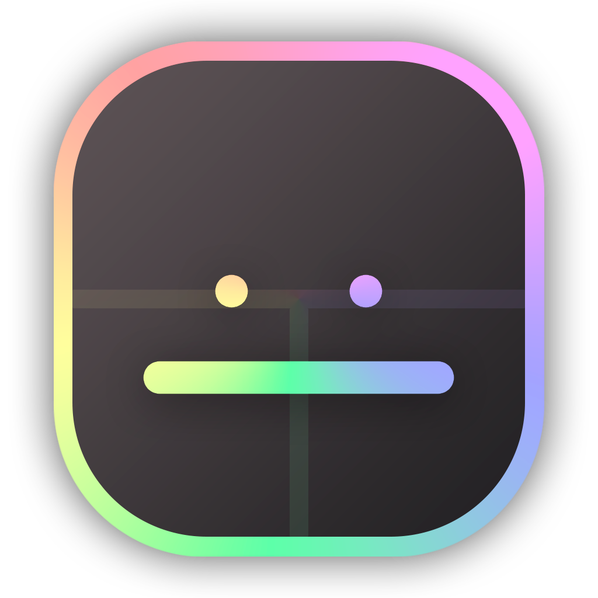

<h1 align="center">Tweakimo 1.8.9</h1>

A miscellaneous mod for Ornithe that uses OneConfig. 99% of the people reading this will not need this mod.

 

## Features
- Configurable with OneConfig
- Always render sky below 4 render distance
- Increased chat message limit to 256 characters
- Added fog options
  - Fog start from 0.0 to 1.0
  - Fog color selector
- Bed Wars height limit HUD
  - Pretty customizable
  - Lowkey just took the idea from Lunar's
  - Shows how close you are to the limit

## ⚠️ Human-made Slop
This code was written by a human being, if it sucks it means said human being didn't have enough coffee that day.
